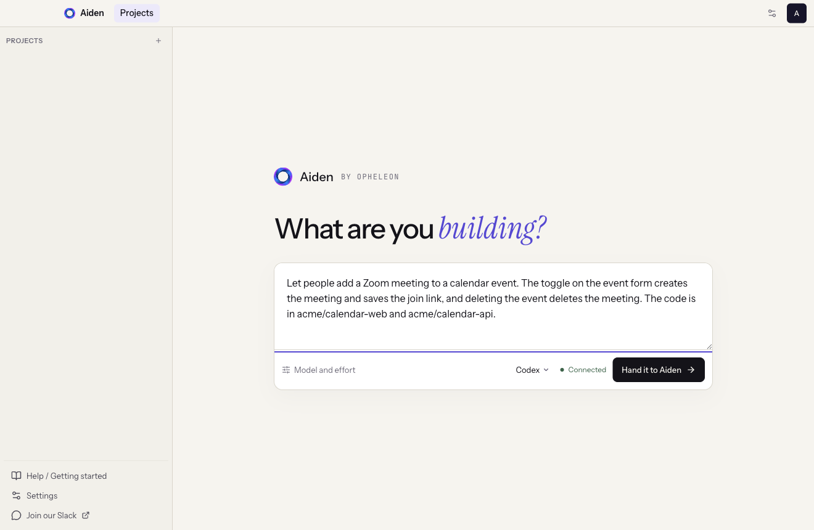
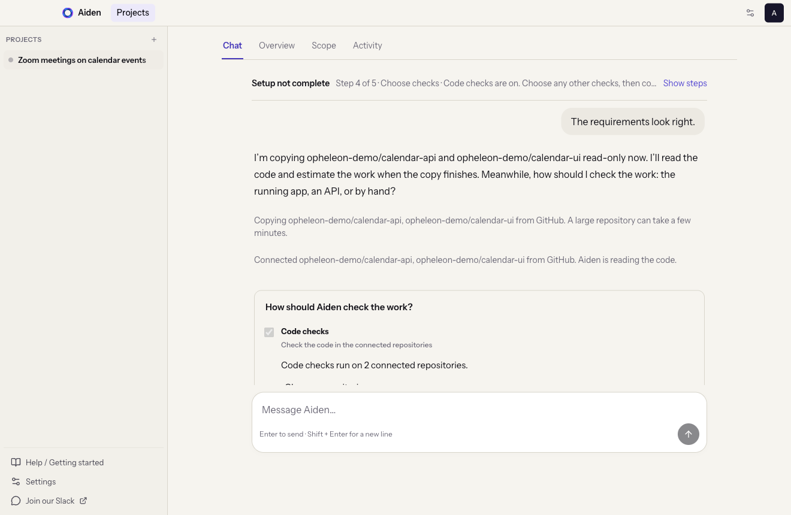

# Aiden

**Your first autonomous project manager.**

Aiden Preview runs on your Mac with your Claude or ChatGPT subscription. Tell it what you're building, or paste a Notion spec, and it writes the requirements, finds your code on GitHub, estimates the work, checks progress, and brings you the decisions that need a person.

You decide what done means, answer the questions only you can, and accept the result.

**Preview · Apple Silicon macOS · Apache 2.0**

[Download for macOS](https://github.com/opheleon/aiden-preview/releases/latest/download/Aiden-arm64.dmg) · [Windows setup](docs/windows-setup.md) · [Getting started](docs/getting-started.md) · [Join our Slack](https://join.slack.com/t/aidenbyopheleon/shared_invite/zt-4apsg5d7p-FDO9ae0imxj~KgauP8lpsw)



Everything starts from one box: describe the goal, or paste a Notion page link. Setup happens in the project's chat.



_A demo project on the opheleon-demo calendar repositories._

## What Aiden does

- **Defines done.** Turns a sentence, a spec, or a linked Notion page (and the pages it links to) into requirements and ordered delivery steps.
- **Reads your code.** Finds the repositories on GitHub, keeps a read-only copy for each project, explores the code, and estimates the remaining work. Without code, it plans the slices but gives no estimate.
- **Follows the work.** Checks pushed code on your chosen branch and shows progress, gaps, and evidence.
- **Keeps decisions visible.** Surfaces blockers and questions in **Needs you**, with estimates when enough evidence is available.
- **Keeps tickets connected.** Optionally publishes the delivery plan to Linear and keeps it in sync while preserving human edits.
- **Records your review.** Accept an outcome with a note, or close a project to pause monitoring and reopen it later.

Aiden monitors projects while the app is open. Code assessments, app checks, and ticket status remain separate evidence; accepting an outcome preserves any failed or unverified checks. Experimental coding-agent dispatch is available by opt-in. Aiden does not merge or deploy code.

## Install

[Download the latest Apple Silicon macOS DMG](https://github.com/opheleon/aiden-preview/releases/latest/download/Aiden-arm64.dmg), open it, and drag Aiden into Applications. Older versions and checksums are on [GitHub Releases](https://github.com/opheleon/aiden-preview/releases). You'll need Git, a supported provider runtime, and for private repositories the [GitHub CLI](https://cli.github.com) signed in (`gh auth login`).

An early, unsigned Windows x64 installer (`Aiden-VERSION-x64.exe`) is on the same release page. Follow the [Windows setup guide](docs/windows-setup.md) to install it and connect your subscription and GitHub from PowerShell. Linux and Intel Macs are outside the current preview scope.

To verify a download, get `SHA256SUMS.txt` from the same release and run these commands, replacing the example DMG filename:

```sh
shasum -a 256 -c SHA256SUMS.txt --ignore-missing
gh attestation verify Aiden-VERSION-arm64.dmg --repo opheleon/aiden-preview
```

Check, download, and restart from the update control at the bottom of the sidebar. Update preferences are under **Settings → Desktop app**. See the [release guide](docs/macos-release.md) for packaging and verification details.

## Quick start

1. Choose Claude or Codex on the start screen. It shows whether the model is connected; **Connect** opens the sign-in steps (also in **Settings → Model**). Claude needs Claude Code and a paid Claude plan; Codex needs its CLI installed separately, since the Codex desktop app alone is not enough. Cursor is not supported.
2. Describe what you're building, or paste a Notion page link. To read Notion pages, connect Notion in **Settings → Integrations**; connecting approves only Notion's fetch and search tools. Name the repositories (such as `acme/web and acme/api`) if you know them.
3. Choose **Hand it to Aiden**. The project opens on its **Chat** tab. Aiden asks any open questions, plays back the requirements for you to confirm, then connects your code: the repositories you named, or it asks which GitHub organization and which repositories to use. Then it asks how to check the work.
4. Review **Overview**, answer questions in **Needs you**, and refine **Scope** as you learn. Connect Linear in **Settings → Integrations** when you want shared tickets.

Your subscription limits or API charges apply; Aiden includes no model credits. Open **Help / Getting started** in the app or read the [getting-started guide](docs/getting-started.md) for more.

## Privacy

Projects, reports, and each project's read-only repository copies are stored locally in `~/.aiden` (or `AIDEN_HOME`). Aiden never pushes to them. Selected context and code evidence are sent to your chosen model provider, so inference is not offline. Aiden does not collect usage metrics or upload diagnostics. See the [security policy](.github/SECURITY.md) and [trust boundaries](docs/architecture.md#trust-boundaries).

## Development

Use the Node version in [`.node-version`](.node-version) and the exact pnpm version in [`package.json`](package.json):

```sh
pnpm install --frozen-lockfile
pnpm dev
```

Run `pnpm check` before contributing. A CLI is also included. See [contributing](.github/CONTRIBUTING.md), [architecture](docs/architecture.md), and [dependency security](docs/dependency-security.md) for development details.

## Support and contributing

Join the [Aiden Slack community](https://join.slack.com/t/aidenbyopheleon/shared_invite/zt-4apsg5d7p-FDO9ae0imxj~KgauP8lpsw) for setup help and feedback, or open a [GitHub issue](https://github.com/opheleon/aiden-preview/issues) for a bug or feature request.

For more detail, see the [daily workflow](docs/daily-workflow.md), [troubleshooting](docs/troubleshooting.md), [changelog](CHANGELOG.md), and [example reports](examples/reports/README.md).

## License

Copyright © 2026 Opheleon. Licensed under [Apache 2.0](LICENSE). See [NOTICE](NOTICE) and [third-party notices](THIRD_PARTY_NOTICES.md).

## Test an iPhone build

Choose verification surfaces during setup or open **Verification** under an existing project. Save browser, API, and installed TestFlight targets, then run manually or after each successful code assessment. See [project verification configuration](docs/verification-configuration.md). See [iPhone verification setup and limits](docs/iphone-verification.md).

Desktop verification launches use `AIDEN_HEADLESS=1`: the real Electron renderer stays hidden, cannot take focus, and still produces screenshots and traces. Browser surface checks also run headlessly. Normal interactive app launches remain visible.
